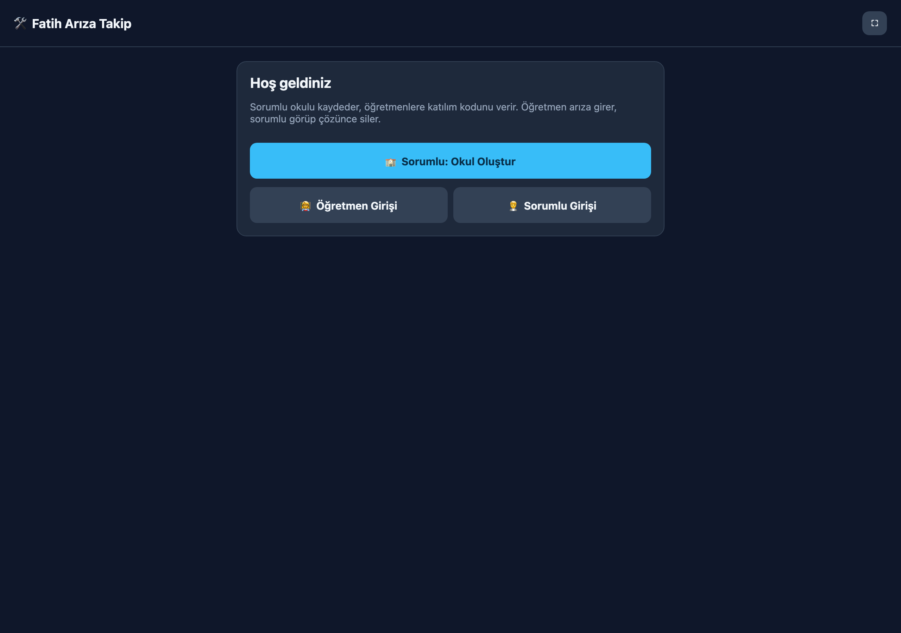

# 🛠️ Fatih Arıza Takip

> A lightweight fault-reporting PWA for schools: teachers report problems, administrators triage and close them, and every step is logged.

[](https://workers.cloudflare.com/)
[](https://developers.cloudflare.com/d1/)
[](https://web.dev/progressive-web-apps/)
[](LICENSE)

<p align="center">
  <a href="https://www.buymeacoffee.com/cmtrkr"></a>
</p>

Fatih Arıza Takip is a small, self-hosted web app for school maintenance workflows. A responsible administrator creates a school and receives two codes: a **teacher join code** and a private **admin code**. Teachers sign in with the join code and their name, report a fault, and see only their own reports. The administrator sees every report, changes its status, prints or exports activity reports, and can remove resolved records.

It runs on the **Cloudflare Workers free tier** with **D1** (SQLite) and a single-page PWA frontend. There is no build step, no npm runtime, and no external service.

## 📸 Screenshot

<p align="center">
  
  <br>
  <sub>The welcome screen — create a school, join as a teacher, or sign in as the responsible administrator.</sub>
</p>

## ✨ Features

- 🏫 **School onboarding** — one form creates a school and two separate access codes.
- 👩‍🏫 **Teacher panel** — join with code + name, report a fault with location, category and description, and track only your own reports.
- 🧑‍💼 **Administrator panel** — see all faults, mark them `bekliyor` / `inceleniyor` / `çözüldü`, view statistics and delete resolved records.
- 📊 **Activity reports** — date-range log report (created, status changed, deleted) with print and CSV export.
- 📱 **Installable PWA** — manifest, service worker, full-screen mode and a 5-second auto-refresh.
- 🔒 **Role separation** — teachers never see each other's reports; admin actions require the admin code.
- 🪶 **Zero dependencies at runtime** — the Worker serves the API and the static PWA from one deployment.

## 🏗️ How it works

```text
Teacher (PWA) ──POST /api/faults──────────┐
                                          ▼
                              Cloudflare Worker (src/index.ts)
                                          │
                                          ▼
                                    D1 / SQLite
                                          ▲
Administrator (PWA) ──PATCH /api/faults/:id
```

The frontend is a single `public/index.html` file. The Worker exposes a JSON API, stores data in D1, and serves the static assets. Sessions are kept in `localStorage` under `fatih_ariza_session`.

## 🚀 Setup

Requirements: Node.js 18+ and a Cloudflare account with Wrangler.

```bash
npm install
npx wrangler login
```

### 1. Create the D1 database

```bash
npm run db:create   # wrangler d1 create fatih-ariza-db
npm run db:migrate  # wrangler d1 execute fatih-ariza-db --file=./schema.sql
```

Copy the resulting `database_id` into the `[[d1_databases]]` block of `wrangler.toml`.

### 2. Run locally

```bash
npm run dev
```

### 3. Deploy

```bash
npm run deploy
```

## 📁 Project structure

```text
├── src/index.ts                  # Worker: API + static asset serving
├── public/
│   ├── index.html                # Whole single-page UI
│   ├── manifest.webmanifest
│   ├── sw.js
│   └── icons/
├── schema.sql                    # D1 schema (schools, faults, logs)
└── wrangler.toml                 # Worker + D1 configuration
```

## 🔌 API

| Method | Endpoint | Description |
| --- | --- | --- |
| `POST` | `/api/schools` | Create a school `{name}` → returns teacher and admin codes |
| `POST` | `/api/join` | Join with a code `{code}` → role + school info |
| `GET` | `/api/faults?schoolId=&code=&teacherToken=&teacherName=` | List faults (teachers see only their own) |
| `POST` | `/api/faults` | Report a fault (teacher) |
| `PATCH` | `/api/faults/:id` | Change status (admin only) |
| `DELETE` | `/api/faults/:id?schoolId=&code=` | Delete a fault (admin only) |
| `GET` | `/api/report?schoolId=&code=&from=YYYY-MM-DD&to=YYYY-MM-DD` | Activity report (admin only) |

## 🔐 Notes and privacy

- Codes are 6 characters from an unambiguous alphabet (`ABCDEFGHJKLMNPQRSTUVWXYZ23456789`).
- Teacher reports are matched by `teacher_token` + `teacher_name`; there is no account or password store.
- Report ranges are limited to one year.
- Use a long random admin code and share it only with the responsible person.
- The app stores only the data needed for fault tracking. Do not enter student personal data in fault descriptions.

## ❤️ Support

If this project saves your school time, you can buy me a coffee:

<p align="center">
  <a href="https://www.buymeacoffee.com/cmtrkr"></a>
</p>

Issues and pull requests are welcome.

## 📄 License

[MIT](LICENSE) © 2026 Cem Türker.

Fatih Arıza Takip is an independent project and is not affiliated with Cloudflare.
